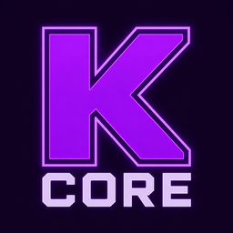

# KoHs Core

[](https://github.com/kerlycanelita/KoHs-Core)
[](https://github.com/kerlycanelita/KoHs-Core/issues)
[](https://discord.gg/9t2VxEF7UU)

<p align="center">
  
</p>

**Graphics controls, performance profiles, and coordination for the KoHs mod family.**

Client-side Fabric mod for Minecraft Java **26.1.2**, using **Java 25**.
Version **1.2.0** adds explicit Latency, FPS and Quality profiles, undo for the
last applied profile, and a frame-time window used by the performance display.

## What it changes

- **Video settings.** Opens Core from Options → Video Settings, with a button
  back to Minecraft's original screen.
- **Profiles.** Applies the selected rendering goal when requested, respects
  settings owned by other mods, and preserves the user's frame cap.
- **Graphics and particles.** Exposes additional quality tiers, per-particle
  controls, shared particle budgets, and distance controls for world text.
- **Animations.** Controls cosmetic animation independently from world ticks.
- **Performance overlay.** Displays FPS, frame times and heap usage. Input
  latency appears only when a sibling mod supplies a fresh measurement.
- **KoHs Suite.** Finds sibling mods and opens their configuration screens when
  they provide one. Shared setting ownership keeps their controls coordinated.
- **JVM guidance.** Explains launch arguments based on the detected hardware.

See the [feature guide](docs/FEATURES.md) for settings, previews, quality tiers,
memory behavior, and integration details.

## Install

1. Install [Fabric Loader](https://fabricmc.net/use/) 0.19.3 or newer and use Java 25.
2. Install Fabric API for Minecraft 26.1.2.
3. Put `kohs-core-1.2.0.jar` in the instance's `mods` folder.
4. Open **Options → Video Settings**. Mod Menu is optional.

## Compatibility

Core yields settings to their registered or detected owner and disables the
corresponding controls. Its integration API is documented in
[INTEGRATION.md](docs/INTEGRATION.md).

Profiles are rendering goals; they do not guarantee a particular FPS or input
latency. JVM arguments must be applied in the launcher before starting the game.

## Building

With JDK 25 available through `JAVA_HOME`:

```powershell
.\gradlew.bat build --no-daemon
```

On Linux or macOS, use `./gradlew build --no-daemon`. The build includes
`coreChecks`, which exercises the profile-change and frame-window logic without
launching Minecraft. The playable output is `build/libs/kohs-core-1.2.0.jar`;
the `-sources.jar` is for development.

## Repository layout

| Location | Contents |
| --- | --- |
| `src/client/` | Settings, profiles, HUD, governors, integration API and Mixins. |
| `src/coreChecks/` | Standalone profile and frame-window checks. |
| `src/main/resources/` | Metadata, languages and UI assets. |
| `docs/` | Feature guide, integration API, research and media. |
| `gradle/` | Gradle Wrapper configuration. |

Start with the [documentation index](docs/README.md). Build output and local
Minecraft instances remain outside Git; keep installable JARs out of the source tree.

## License

MIT. See [LICENSE](LICENSE).

## Credits

Made by **zymekoh**.
